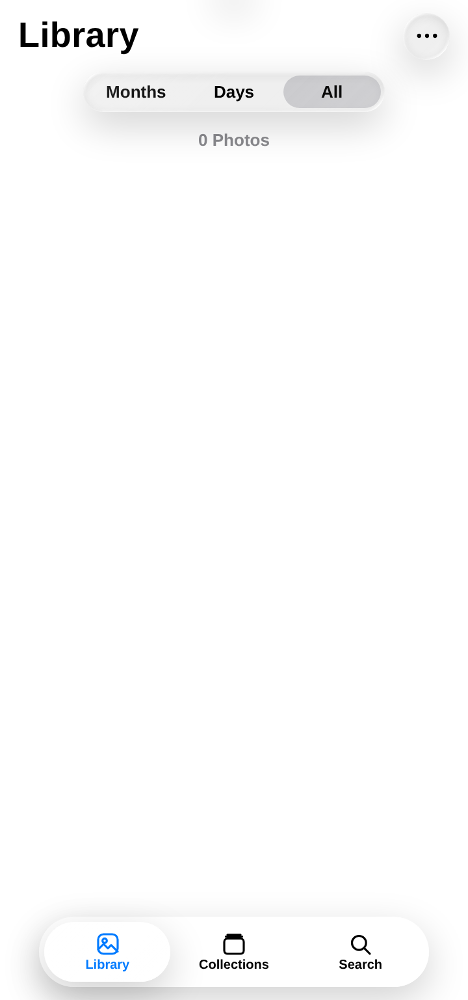
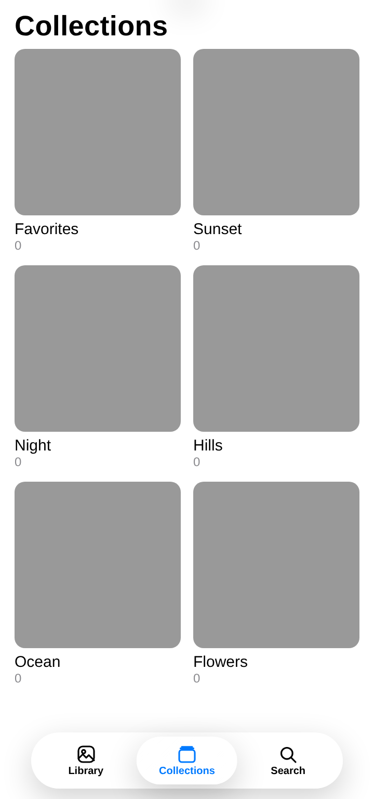
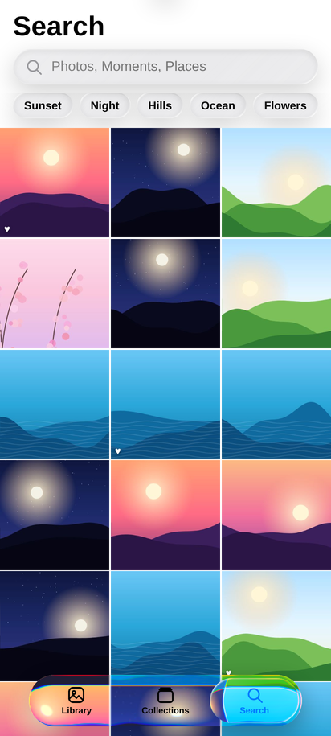
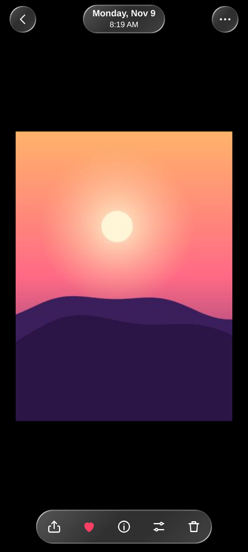
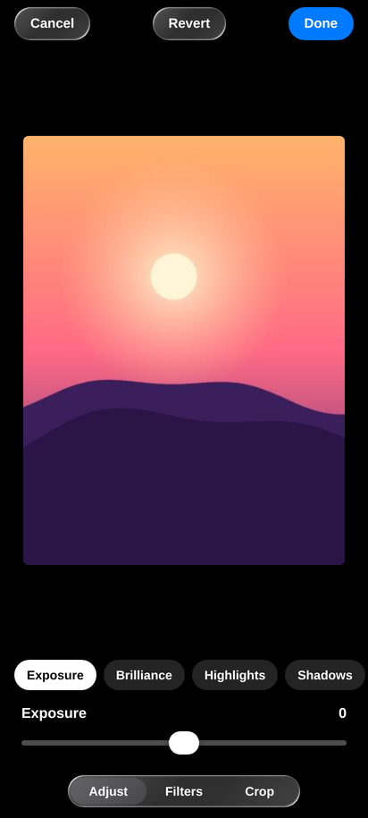
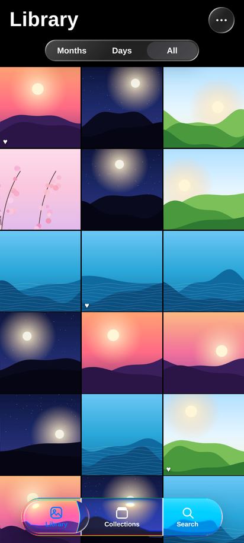

# Photos — Android APK

A native Android build of a self-contained HTML photo-gallery UI. The entire interface is one
44 KB HTML file (liquid-glass tab bar, viewer, and a full non-destructive editor); this repository wraps it in a small Java WebView shell so it installs and launches like a
normal app — no browser chrome, no network, no permissions beyond vibration.

**Download:** [Photos.apk](https://github.com/technicalnihilist-lgtm/photos-android/releases/latest) (90 KB, Android 7.0+, v1.3)

<p align="center">
  
  
  
</p>
<p align="center">
  
  
  
</p>

## What it does

- **Library** — three-column grid with Months / Days / All grouping, favourite markers and counts.
- **Collections** — albums generated from the same seed (Favorites, Sunset, Night, Hills, Ocean, Flowers).
- **Search** — live filtering with suggestion chips.
- **Viewer** — full-screen photo, date pill, share / favourite / info / edit / delete controls.
- **Editor** — exposure, brilliance, highlights, shadows, filters and crop, applied on canvas.
- **Liquid glass** — the tab bar and floating controls re-render what is behind them and refract it
  (Safari gets blur + specular; Chromium/WebView also gets true refraction).
- **Dark mode** — follows the system theme, with status-bar icons switched to match.

Everything is offline and the APK is under 100 KB. The library starts **empty** — no demo or sample
photographs ship with the app.

## Native shell (what the Java adds)

| Behaviour | Implementation |
| --- | --- |
| Page hosting | Full-screen `WebView` loading `file:///android_asset/index.html` |
| Edge-to-edge | `setDecorFitsSystemWindows(false)` + system-bar insets applied as padding on a wrapper view around the WebView, `shortEdges` cutout mode |
| Back button | `onBackPressed` → `window.__back()` in the page, which closes menu → info sheet → editor → viewer in order, then exits |
| Share | `AndroidBridge.share()` (`@JavascriptInterface`) opens the real `ACTION_SEND` chooser; a shim exposes it as `navigator.share` |
| Theme | `uiMode` config change switches bar icons and window background; the page's `prefers-color-scheme` follows automatically |
| Permissions | `VIBRATE` only (for the haptic tap feedback) |

## Build from source

Requirements: JDK 17, Android SDK with `platforms;android-34` and `build-tools;34.0.0`.

```bash
export ANDROID_HOME=/path/to/android-sdk
bash build.sh       # produces ./Photos.apk signed with a generated debug keystore
adb install Photos.apk
```

`build.sh` runs the whole pipeline by hand — `aapt2 compile` → `aapt2 link` → `javac` → `d8` →
`zipalign` → `apksigner` — with no Gradle.

## Repository layout

```
app/
  AndroidManifest.xml                     package com.nihao.photos, minSdk 24, targetSdk 34
  src/com/nihao/photos/MainActivity.java  the WebView shell
  assets/index.html                       the app UI (single file, no external requests)
  res/                                    label, theme, adaptive launcher icon
  tools/mkicon.py                         regenerates the launcher icon PNGs (Pillow)
build.sh                                  aapt2 + javac + d8 + apksigner pipeline
Photos.apk                                prebuilt, debug-signed (APK Signature Scheme v2 + v3)
screenshots/                              rendered from the page at 412x915
```

## Notes and limitations

- The APK is signed with a **debug key** (`CN=Android Debug`), which is fine for sideloading and
  testing but is not suitable for the Play Store. Use your own release keystore to publish.
- "Delete" removes a photo from the in-memory session only; it never touches the device gallery, and
  favourites/deletions are not persisted between launches.
- The screenshots are rendered from the same `index.html` in headless Chromium, which is the same
  engine Android WebView uses, so they match what the APK shows.
- The page was authored as an HTML prototype; this repository adds only the native shell, the build
  pipeline and the packaging — the UI logic is unchanged apart from an appended 20-line shim for
  back-button and share bridging.
